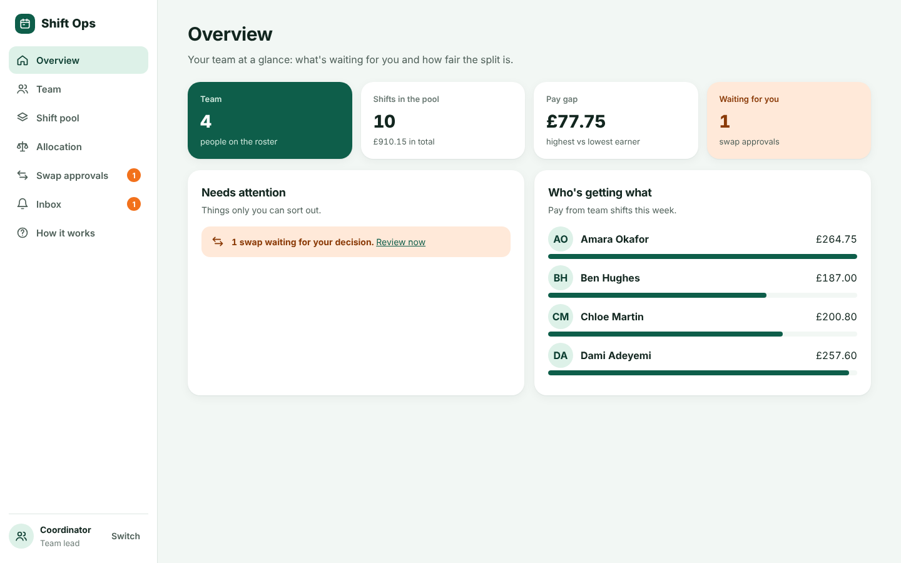
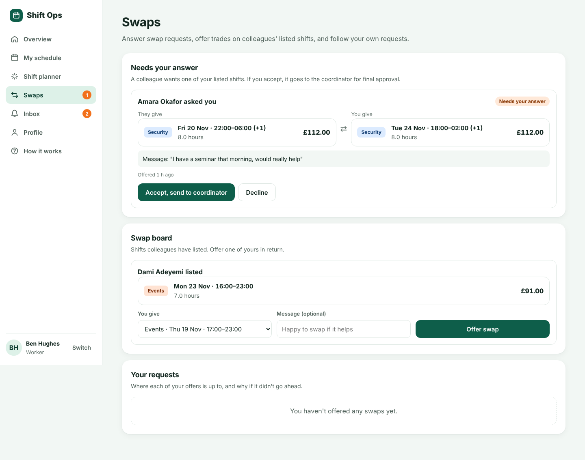
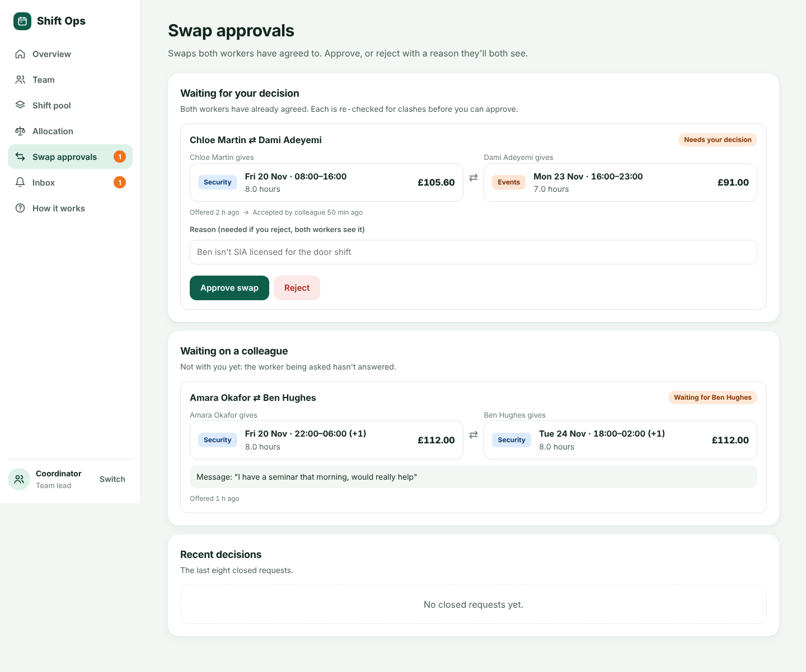
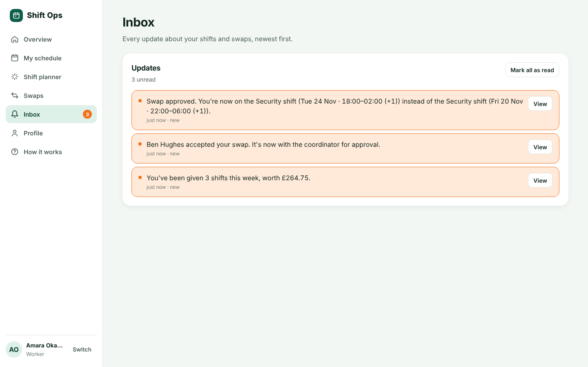
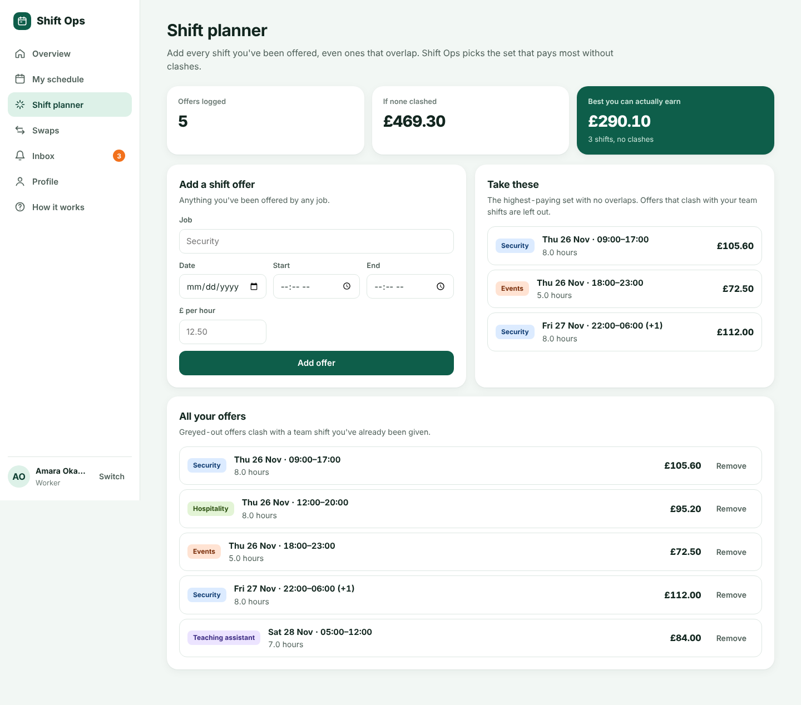
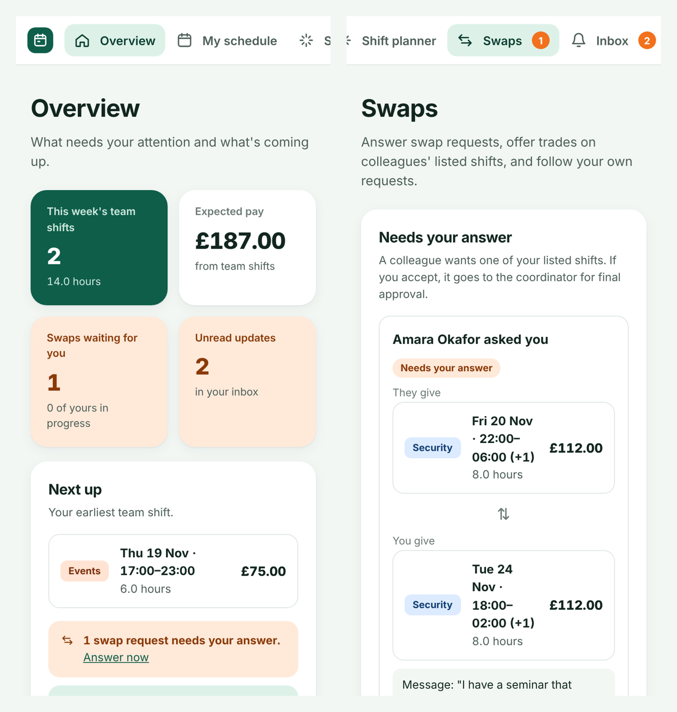

# Shift Ops

I work several zero hours jobs at once (hospitality, events, teaching
assistant, security) alongside my degree, and the actual problem that
started this was simple: shift offers from different jobs overlap all the
time, and picking which ones to take without double booking myself was
something I was doing by eye, badly.

The first version I built was basically a timesheet with a calendar. It
worked, but it didn't really solve anything, it just logged what I'd
already decided. So I rebuilt the core of it around an actual algorithm:
given a pile of overlapping shift offers, find the combination that pays
the most without any clashes. That's a textbook problem (weighted interval
scheduling) solved with dynamic programming, and it's the part of this
project I'd actually want to be asked about in an interview.

From there I widened the scope. The same kind of problem exists on the
other side too: if a coordinator has a pool of open shifts and several
staff, how do you split it so nobody gets stuck with the worst hours while
someone else cherry picks the good ones. That's handled with a greedy
load balancing approach (the same family of algorithm used for balancing
load across machines, just applied to people here), plus a local search
step afterwards that looks for small trades between the highest and lowest
earner that narrow the gap.

The swap feature went through a redesign I'm fairly proud of. My first
version let anyone browse a colleague's entire shift list to request a
swap, which on reflection is a bad idea: it exposes someone's full
schedule and effectively their earnings to anyone else on the team, which
is the kind of thing that breeds resentment rather than solving a
logistics problem. I changed it so a shift only becomes visible to others
once its owner explicitly lists it for trade. Nobody can browse anyone
else's schedule. That one decision mattered more to me than any of the
algorithm work, because it's the difference between building something
that works and building something people would actually be okay using.

**Try it:** https://d4smond.github.io/Shift-ops/ — hit *Load sample team*
on the sign-in screen, then sign in as the coordinator (`LEAD123`) or as
one of the workers (`WORKER123`). Ben has a swap request waiting for him,
and the coordinator has one to approve.





## What it actually does

Two roles, gated behind a sign-in screen (a UI simulation for the demo,
not real authentication; the access codes are shown on the page on
purpose).

**Workers** get seven tabs:

| Tab | What it's for |
| --- | --- |
| Overview | What needs your attention, your next shift, expected pay, latest updates |
| My schedule | Team shifts you've been given, day by day, with a button to list any for swap |
| Shift planner | Log every shift offer from every job, even overlapping ones, and get the best clash-free set |
| Swaps | Answer requests for your listed shifts, offer trades on colleagues' listings, follow your own requests |
| Inbox | Every update about your shifts and swaps |
| Profile | Photo and a line about you, shown to the coordinator |
| How it works | Plain-English guide to every tab and the algorithms |

**Coordinators** get Overview, Team, Shift pool, Allocation, Swap
approvals, Inbox and How it works.

## Swaps, version 3

The old swap flow had two real problems: the person whose shift was being
asked for never got a say, and when the coordinator rejected a swap nobody
was told. Now:

1. A worker lists a shift. Only that shift becomes visible to colleagues.
2. A colleague offers one of their own shifts for it, with an optional message.
3. **The worker who listed it accepts or declines** (with an optional reason). The colleague is told either way.
4. If accepted, the coordinator **approves, or rejects with a reason that's required**. Both workers are told the outcome and why.
5. If either person's shifts change in the meantime (a new allocation, another approved swap), the request closes automatically and everyone involved is told.

Every request keeps a history, so anyone can see where it's up to:
"Offered 2 h ago → Accepted by colleague 50 min ago → Approved".



## Notifications

There's an inbox for every worker and the coordinator, with an unread
count on the tab. People are told when:

- the coordinator shares out shifts (how many, and what they're worth)
- someone offers a swap for their listed shift
- their offer is accepted, declined (with the reason), approved or rejected (with the reason)
- the coordinator applies a suggested swap that moves them
- a request is closed because the shifts changed



## The look

The first version was a dark theme that felt heavy. Version 3 is "daylight
operations": an evergreen brand colour that reads professional, tangerine
only for things that need you, a soft mint background with white cards,
and a tint per job type (sky for security, peach for events, pistachio for
hospitality, lavender for teaching) so a schedule reads at a glance. The
font is Plus Jakarta Sans. On a phone the sidebar becomes a scrolling tab
row.





## The actual logic, if you want to dig in

**Personal scheduler.** Sorts a worker's shift offers by end time, then
for each one decides to take it or skip it based on whichever choice
leaves more total value available, using a dynamic programming table and
backtracking at the end to recover which shifts were actually chosen. The
"last shift that finishes before this one starts" lookup is a binary
search, so the whole thing is O(n log n). Any offer that clashes with a
shift the coordinator has already given you is greyed out and left out of
the calculation, since you can't take it anyway.

**Fair allocation.** Sorts the open shift pool by value, highest first,
and hands each shift to whichever eligible worker currently has the
lowest running total. Eligible just means it doesn't clash with anything
they've already been given.

**Swap suggestions.** After allocation, compares the highest and lowest
earner and checks every possible one for one trade between their shifts,
keeping any that narrows the gap without creating a new clash for either
person.

**Worker submitted swaps.** See "Swaps, version 3" above. The same clash
check runs three times: when the offer is made, when the colleague
accepts, and again when the coordinator approves, because shifts can move
in between.

## How it's built

Plain HTML, CSS and JavaScript, no frameworks.

```
index.html              the page
css/styles.css          styling
js/scheduling.js        shift maths: clashes, the planner, fair allocation, swap checks
js/swaps.js             the swap request workflow and who gets told at each step
js/store.js             saving everything to localStorage in one place
js/app.js               the tabs, sign in and buttons
tests/                  unit tests for scheduling.js and swaps.js
docs/screenshots/       screenshots used in this README
```

Keeping the algorithms in their own file was the main point of the
refactor: it means I can test them properly without clicking through the
UI. Everything (the roster, the
shift pool, each worker's personal offers, the allocation result, swap
requests, profile photos and bios) is stored in the browser's
localStorage, which is enough to demonstrate the whole thing working
without needing a backend. Role sessions are kept separately so switching
between worker and coordinator views doesn't wipe the underlying data.

## Tests

```
node --test
```

Uses Node's built-in test runner (Node 18+), nothing to install. 23 tests.
The most useful one generates 200 random sets of shifts, works out the
true best answer by brute force (every possible combination), and checks
the DP always matches it. The swap tests check that nobody can skip a
step: the coordinator can't approve before the colleague accepts, only
the person asked can answer, a rejection without a reason is refused, and
every step sends the right people the right message.

## Bugs I fixed in version 2

That brute force test is what showed the first version was wrong
sometimes. It only compared shifts that were on the same date, so a
22:00–06:00 night shift and a 05:00 start the next morning didn't count as
a clash, and it sorted overnight shifts by the wrong end time. Times are
now converted to one continuous timeline so overnight shifts work
properly. Other fixes:

- Names and job titles are escaped before going into the page, so typing
  HTML into a name field can't run code on someone else's screen.
- Approving a swap now expires any other pending offers involving the same
  shifts, and removes their listings, instead of leaving them stuck as
  "pending" forever.
- Workers get told straight away if a trade would double-book someone,
  and can't send the same offer twice.
- Totals are recalculated from the actual shifts after every change rather
  than added/subtracted, so they can't drift out of sync.
- Profile photos are shrunk to 160px before saving, because a full-size
  phone photo could fill localStorage on its own.
- Coordinator gets a warning if the pool has changed since the last
  allocation was run.
- Signing back in always lands on the Shifts tab (a coordinator could
  previously end up on the worker-only Profile tab).

## What I'd actually change if I kept building this

Real accounts instead of the demo access codes. A minimum rest gap
between shifts, since right now it only avoids full overlaps, not back to
back closing and opening shifts. Export to a calendar file. And probably
a backend, since localStorage only works for one browser on one device,
which is fine for a demo but not for anyone actually using this.
